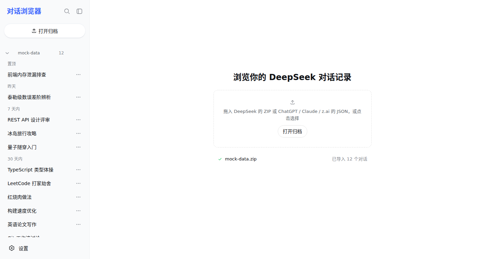
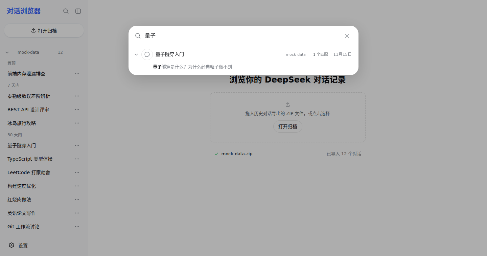
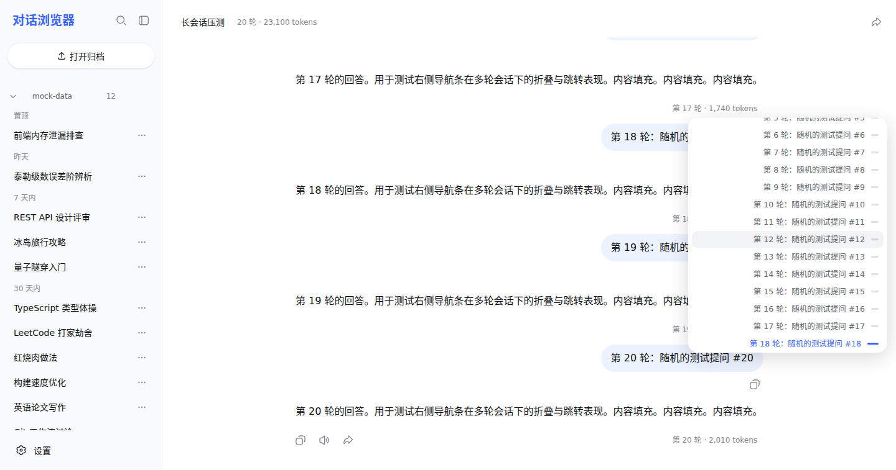
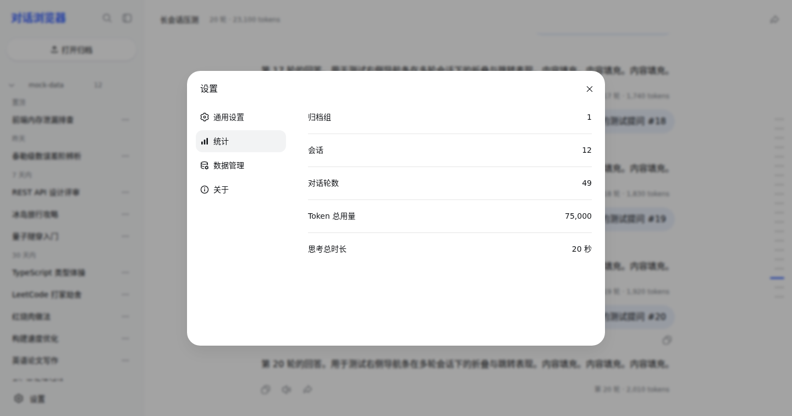

# chatbrowser

English | [简体中文](README.zh-CN.md)

A **local AI chat history browser** forked from [deepseek-ai/chat-demo](https://github.com/deepseek-ai/chat-demo). It never calls an API: load exported files (DeepSeek ZIP; ChatGPT / Claude / z.ai ZIP or JSON) and browse them entirely offline.

> **Credits**: built by **GLM-5.3-Flash (Z.ai)** and **DeepSeek-V4.1-Flash-1017**; the human participant contributed the original idea and feedback. The UI and message rendering pipeline come largely from the upstream [deepseek-ai/chat-demo](https://github.com/deepseek-ai/chat-demo).

## Use online (GitHub Pages)

Open **https://happy129429.github.io/chatbrowser/** — nothing to install.

- Data lives in the current browser's IndexedDB, scoped to that site
- It is **separate** from the desktop and Android builds
- The Pages site is redeployed automatically on every push to main (the release flow pushes main first)
- There is no "Quit app" section in the browser build; just close the tab

## Quick start

1. **Import**: drop an export file onto the welcome screen, or use "Open archive" / Settings → Data
2. **Browse**: pick a conversation on the left; use the round navigator to jump, the reading position is remembered
3. **Organize**: the conversation `…` menu renames/pins/shares/exports; the group header menu colors, merges and shows "Archive notes"
4. **Search**: top-right search or `Ctrl/⌘ K`, then click a result to jump
5. **Export**: "Share" on a conversation exports selected rounds as HTML/Markdown; "Export as…" writes an archive ZIP or Claude JSON

> See the deployment options above; privacy, disclaimer and trademark notes are below.

## Screenshots

| Archive list                               | Global search                                 |
| ------------------------------------------ | --------------------------------------------- |
|  |  |

| Round navigation                                    | Statistics                                |
| --------------------------------------------------- | ----------------------------------------- |
|  |  |

## Ways to use and deploy

| Option                    | Best for                                       | How to start                                                          |
| ------------------------- | ---------------------------------------------- | --------------------------------------------------------------------- |
| Web                       | No install, quick look                         | Open https://happy129429.github.io/chatbrowser/                       |
| Self-hosted static site   | Private deployment, intranet/NAS, full control | Run `pnpm build` and serve `dist/` from any static server             |
| Desktop (Windows/Linux)   | Long-term, stable data                         | Download `windows-x64.zip` / `linux-x64.tar.gz` from Releases         |
| Windows portable (no exe) | Cannot run an exe or Defender blocks it        | Download `windows-portable.zip`, double-click `start-chatbrowser.cmd` |
| Android                   | Phone                                          | Install `chatbrowser-android.apk` from Releases                       |

### Self-hosted static site (private deployment)

No backend, database or API key: host the build output like any static website.

```sh
pnpm install
pnpm build
# upload the dist/ directory to your server
```

- Works with nginx / Caddy / Apache / a NAS web server / object storage static hosting
- The app has no client-side router, so no SPA rewrite rules are required; the directory just needs `index.html` and `static/`
- **Keep the URL stable**: data is scoped to the origin (scheme + host + port); changing domain/port shows an empty library
- HTTPS is recommended; plain HTTP on an intranet works but some browser APIs are limited
- Private deployment uploads no conversation data; the update check still requests the GitHub API, which can be blocked at the network level
- Example (nginx, deployed under a subpath):

```nginx
location /chatbrowser/ {
  alias /srv/chatbrowser/dist/;
  try_files $uri $uri/ /chatbrowser/index.html;
}
```

### Desktop (Windows / Linux)

- Windows: extract `windows-x64.zip` and double-click `chatbrowser.exe`; it opens a chromeless Edge/Chrome window
- No exe: `windows-portable.zip` → double-click `start-chatbrowser.cmd` (served by PowerShell, avoids unsigned-exe blocking)
- Linux: extract `linux-x64.tar.gz`, run `./chatbrowser`; install `chatbrowser.desktop` for the app menu
- The local server is fixed at `http://127.0.0.1:17890`, so data persists across launches
- Closing the window keeps the launcher running; use Settings → Quit app to stop it and release the executable

### Android

- Install the debug-signed APK (Android 6+), then import ZIP/JSON files
- Exports are written to the system **Documents** folder (WebView cannot download blob URLs)

## Import formats and support level

| Format                                          | Support                                                 | What is preserved                                                                                                                                      |
| ----------------------------------------------- | ------------------------------------------------------- | ------------------------------------------------------------------------------------------------------------------------------------------------------ |
| **DeepSeek export ZIP** (`deepseek_data-*.zip`) | **Most complete** (same origin as the upstream project) | Branch tree, reasoning, tool steps, web search sources, original images, token usage                                                                   |
| ChatGPT export (ZIP/JSON)                       | Compatibility import                                    | Active branch, system prompts, memories/custom instructions; no tool steps or original images                                                          |
| Claude export (ZIP/JSON)                        | Compatibility import                                    | Conversation summary, original message UUID/parent chain, thinking blocks (truncated/hidden/signature), citations, attachment filenames (no originals) |
| z.ai / OpenWebUI native exports                 | Compatibility import                                    | `chat.history.messages` object tree + `currentId`, imports the active branch; content may be missing in the vendor export                              |
| `turn_history` envelopes                        | Compatibility import                                    | `session_metadata` / `global_context` system instructions                                                                                              |

DeepSeek is the upstream project's native format and the base for this app's archive and conversion pipeline, so it has the most complete support. Other formats aim to migrate without losing information where possible; depending on what each vendor exports, some fields can only be dropped or kept as metadata.

- Import multiple files at once; each import becomes an archive group with incremental merges
- System prompts are viewable inside external conversations; account-level memories/instructions from the group menu

## Features

- Full rendering: Markdown, code highlighting, KaTeX, Mermaid, reasoning timeline, web search sources, message branches and attachments
- External conversation summaries (Claude `summary`) appear as a collapsible panel; attachments without originals show name/type
- Safety-refused replies show only the notice by default; in the archive you can use "Show original content" to reveal the reasoning and text that were sent
- Archive groups: rename, color, collapse, move sessions, merge, dissolve, export as ZIP, delete
- Global search with highlighted excerpts and jump-to-message; cached index per data version
- Export as…: groups or single conversations to AI Assistant-compatible ZIP, AI Assistant extended ZIP (sidecar keeps system prompts, summaries, group info, citations and thinking state), or Claude JSON (thinking/citations/attachment metadata); includes an option to anonymize IDs
- Round-level export: self-contained HTML (MathML, Prism, sources) or Markdown
- Round navigation, scroll restoration, session restore, read-aloud, token/round statistics
- Chinese/English UI (follows the browser by default), light/dark themes, mobile layout

## Data and storage

- Sessions, groups and attachments live in IndexedDB; locale, theme and scroll positions in localStorage
- No network requests except links you click and the update check (GitHub API)
- Storage is isolated per origin:

| Entry point      | Origin                          |
| ---------------- | ------------------------------- |
| Web app          | `https://happy129429.github.io` |
| Desktop launcher | `http://127.0.0.1:17890`        |
| Dev server       | `http://localhost:8090`         |
| Android          | `https://localhost`             |

## Known issues

- The desktop launchers are unsigned: SmartScreen/Defender may warn; use the portable build or unblock the ZIP before extracting
- The launcher uses a fixed port; a newer build closes a stale older instance, the portable build asks you to close it first
- No sync or built-in backup between entries/browsers — export a group ZIP before switching
- Vendor export formats may change; attach a sanitized sample when reporting import issues
- z.ai's "export archived conversation" may only include the first user prompt; the remaining message bodies are missing from the export itself

## Privacy

- Conversations, groups, attachments and settings stay in your browser (IndexedDB / localStorage). Nothing is uploaded; data is **not encrypted at rest**, and clearing browser data or uninstalling the app deletes it permanently
- No accounts, analytics, telemetry or ads; the app does not read data from other websites
- There are only two kinds of network requests: source links you click, and the update check against `api.github.com`. For the latter GitHub can see your IP address, User-Agent and request time (standard HTTP logs); **no local conversation data is sent**. Results are cached for 24 hours
- To delete local data use Settings → Data → Delete all conversations

## Disclaimer

- This software is provided "as is" under GPL-3.0-or-later, without warranties of any kind; the authors are not liable for data loss, incorrect exports or vendor format changes
- Only import data you have the right to use. Importing other people's conversations may involve their privacy; make sure you have permission
- Desktop builds are unsigned and may be blocked by SmartScreen/Defender; obtain them only from this repository's Releases or build from source
- This is an unofficial project with **no affiliation with or endorsement by** DeepSeek, Anthropic, OpenAI or Zhipu

## Trademarks

DeepSeek, ChatGPT, Claude, z.ai and other names/trademarks belong to their respective owners. Their use here only describes file formats and compatibility, and does not imply any official partnership or endorsement.

## Development

```sh
pnpm install
pnpm dev          # http://localhost:8090
pnpm build        # static site → dist/
pnpm type && pnpm lint && pnpm e2e
```

| Command                              | Purpose                                                                                    |
| ------------------------------------ | ------------------------------------------------------------------------------------------ |
| `pnpm mock`                          | Generate mock archives and external samples                                                |
| `pnpm e2e`                           | Headless smoke tests (Chrome required)                                                     |
| `pnpm shots`                         | Regenerate README screenshots (dev server on 8090)                                         |
| `python3 scripts/sanitize-export.py` | Deterministic export sanitizer (same shape/types; `--drop-keys` removes suspicious fields) |
| `pnpm icons`                         | Generate platform icons from `assets/icon.svg`                                             |
| `pnpm desktop`                       | Build Windows/Linux launchers → `release/desktop`                                          |
| `pnpm android:apk`                   | Build the debug APK                                                                        |

See [docs/release-checklist.md](docs/release-checklist.md) for the release process; the archived native-shell proposal lives in [docs/technical-outlook.md](docs/technical-outlook.md).

## License

Released under [GPL-3.0-or-later](LICENSE). The upstream [deepseek-ai/chat-demo](https://github.com/deepseek-ai/chat-demo) is MIT-licensed; its notice is preserved in [LICENSE](LICENSE). Third-party dependencies keep their own licenses.
