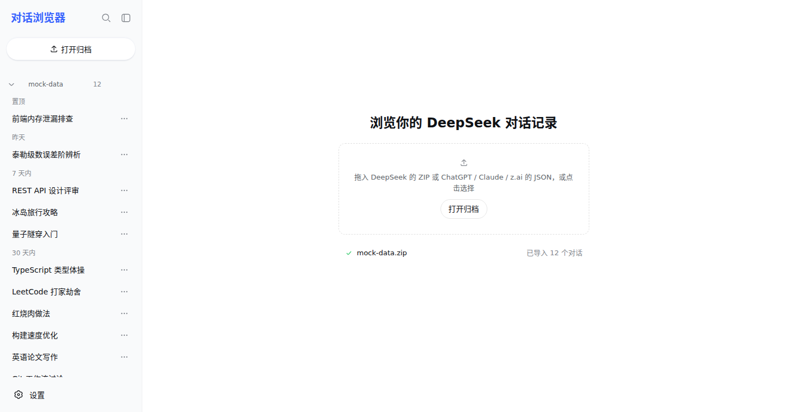
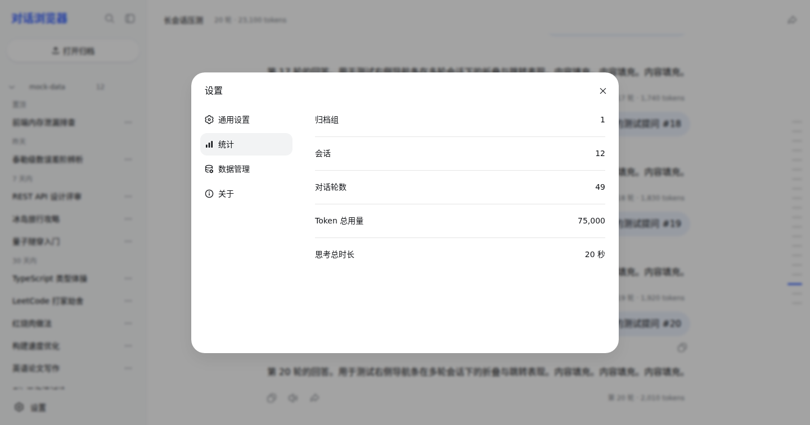

# chatbrowser

[English](README.md) | 简体中文

基于 [deepseek-ai/chat-demo](https://github.com/deepseek-ai/chat-demo) fork 的**本地 AI 对话历史浏览器**：不连接任何 API，只加载导出文件（DeepSeek ZIP；ChatGPT / Claude / z.ai 的 ZIP 或 JSON），完全本地运行。

> **致谢**：本项目由 **GLM-5.3-Flash（Z.ai）** 与 **DeepSeek-V4.1-Flash-1017** 开发，人类参与者仅提出原始想法与反馈。界面与消息渲染管线大量来自上游 [deepseek-ai/chat-demo](https://github.com/deepseek-ai/chat-demo)，特此致谢。

## 在线使用（GitHub Pages）

打开 **https://happy129429.github.io/chatbrowser/** 即可使用，无需安装。

- 数据保存在当前浏览器的 IndexedDB 中，按网站域名隔离
- 与桌面版、Android 版**不是同一份数据**（各自独立）
- 每次发布新版本 tag，Pages 站点会自动重新部署
- 浏览器地址栏页面没有「退出应用」子项，关闭标签页即可

## 截图

| 归档列表                               | 全局搜索                                 |
| -------------------------------------- | ---------------------------------------- |
|  |  |

| 轮次导航                                    | 统计                                |
| ------------------------------------------- | ----------------------------------- |
|  |  |

## 三种使用方式

| 方式    | 适合场景           | 获取与启动                                                                 |
| ------- | ------------------ | -------------------------------------------------------------------------- |
| 网页版  | 不想安装，临时使用 | 打开 https://happy129429.github.io/chatbrowser/                            |
| 桌面版  | 长期使用、数据稳定 | 下载 Release 里的 `windows-x64.zip` / `linux-x64.tar.gz`，解压后双击启动器 |
| Android | 手机查看           | 下载 Release 里的 `chatbrowser-android.apk` 安装                           |

### 桌面版（Windows / Linux）

- Windows：解压 `windows-x64.zip`，双击 `chatbrowser.exe`；自动用 Edge/Chrome 打开无地址栏窗口
- 免 exe：`windows-portable.zip` 解压后双击 `start-chatbrowser.cmd`（PowerShell 伺服，规避未签名拦截）
- Linux：解压 `linux-x64.tar.gz`，运行 `./chatbrowser`；`chatbrowser.desktop` 可放进应用菜单
- 本地服务固定为 `http://127.0.0.1:17890`，因此数据可跨启动保留
- 关闭窗口后启动器仍在后台运行；需要彻底退出并释放 exe 文件时，用「设置 → 退出应用」

### Android

- 直接安装 debug 签名 APK（Android 6+），打开后导入 ZIP/JSON
- 导出文件保存到系统的**「文档」目录**（WebView 不支持 blob 下载链接）

## 导入格式

- DeepSeek 官方导出 `deepseek_data-*.zip`（完整管线：分支、工具步骤、图片、思考内容）
- ChatGPT 导出（`conversations.json` ZIP，含 `mapping` 树）
- Claude 导出（`conversations.json` ZIP，含 `chat_messages` / `content` 数组）
- z.ai 等通用格式（`messages` / `chat_history` 等字段）
- 支持一次导入多个文件；每次导入生成一个归档组，**增量导入**，不覆盖已有数据
- 外部对话保留系统提示词（会话内可查看），账号级记忆/自定义指令/项目提示词从组菜单「附加信息」查看

## 功能

- 完整渲染归档：Markdown、代码高亮、KaTeX、Mermaid、深度思考时间线、联网搜索与来源、消息分支切换、图片附件
- 归档组管理：重命名、配色、折叠、组间移动、合并、解散、导出组 ZIP、删除
- 全局搜索：标题/提问/回答正文，摘录高亮、点击定位；按数据版本缓存索引
- 按轮次导出：自包含 HTML（渲染结果、MathML、代码高亮、来源）或 Markdown
- 轮次导航、阅读位置记忆、刷新恢复会话、朗读、统计面板（轮数/token/思考时长）
- 中英文界面（默认跟随浏览器）、明暗主题、移动端布局

## 数据与存储

- 会话、分组、附件存于浏览器 IndexedDB；语言、主题、阅读位置存于 localStorage
- 除你主动点击的来源链接与更新检查（GitHub API）外，不发起网络请求
- 各入口的数据互相独立：

| 入口                 | origin                          |
| -------------------- | ------------------------------- |
| 网页版               | `https://happy129429.github.io` |
| Windows/Linux 启动器 | `http://127.0.0.1:17890`        |
| 开发服务器           | `http://localhost:8090`         |
| Android              | `https://localhost`             |

## 已知问题

- 桌面启动器未签名：Windows SmartScreen/Defender 可能提示；可用免 exe 便携版，或解压前右键 ZIP → 属性 → 解除锁定
- 启动器固定端口：新版会自动结束占用端口的旧实例；便携版会提示先关闭旧窗口
- 数据不跨入口/浏览器同步，也没有内置备份；换浏览器或换入口前请先导出组 ZIP
- 外部格式官方改版后可能需要补充字段映射，反馈时请附脱敏样本

## 开发

```sh
pnpm install
pnpm dev          # http://localhost:8090
pnpm build        # 静态站点 → dist/
pnpm type && pnpm lint && pnpm e2e
```

| 命令               | 说明                                          |
| ------------------ | --------------------------------------------- |
| `pnpm mock`        | 生成 mock 归档与外部格式样例                  |
| `pnpm e2e`         | 无头冒烟测试（需 Chrome）                     |
| `pnpm shots`       | 重新生成 README 截图（需 dev server 在 8090） |
| `pnpm icons`       | 从 `assets/icon.svg` 生成各平台图标           |
| `pnpm desktop`     | 构建 Windows/Linux 启动器 → `release/desktop` |
| `pnpm android:apk` | 构建 debug APK                                |

目录结构：

```text
src/
  app/                 应用布局与主题
  components/          侧栏、会话视图、消息渲染、搜索、设置
  i18n/                中英文案
  services/chat/       会话、归档组、存储、搜索、导入导出
  services/markdown/   Markdown、代码高亮、图表
packaging/launcher/    Go 桌面启动器（内嵌 dist）
scripts/               构建、mock、e2e、截图
```

发布流程见 [docs/release-checklist.md](docs/release-checklist.md)；曾讨论的原生外壳方案存档在 [docs/technical-outlook.md](docs/technical-outlook.md)。

## 许可证

以 [GPL-3.0-or-later](LICENSE) 再发布。上游 [deepseek-ai/chat-demo](https://github.com/deepseek-ai/chat-demo) 以 MIT 许可发布，其声明保留在 [LICENSE](LICENSE) 中。第三方依赖遵循各自许可证。
