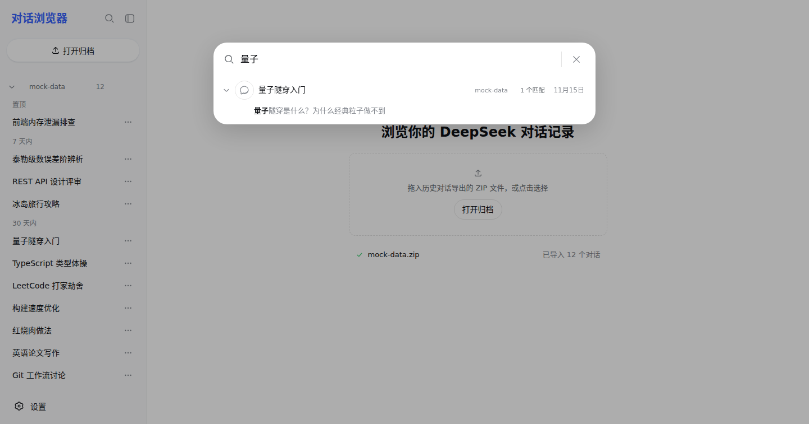
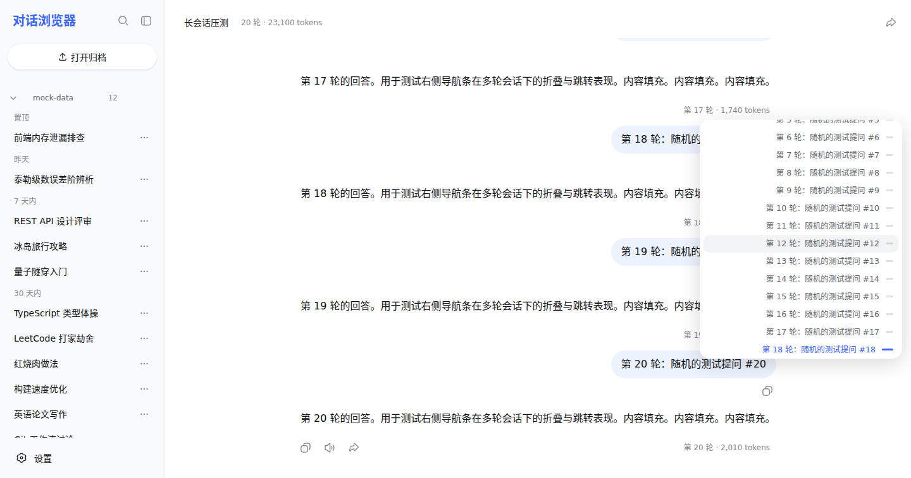

# chatbrowser

[English](README.md) | 简体中文

基于 [deepseek-ai/chat-demo](https://github.com/deepseek-ai/chat-demo) fork 的**本地 AI 对话历史浏览器**：不连接任何 API，只加载导出文件（DeepSeek ZIP；ChatGPT / Claude / z.ai 的 ZIP 或 JSON），完全本地运行。

> **致谢**：本项目由 **GLM-5.3-Flash（Z.ai）** 与 **DeepSeek-V4.1-Flash-1017** 开发，人类参与者仅提出原始想法与反馈。界面与消息渲染管线大量来自上游 [deepseek-ai/chat-demo](https://github.com/deepseek-ai/chat-demo)，特此致谢。

## 在线使用（GitHub Pages）

打开 **https://happy129429.github.io/chatbrowser/** 即可使用，无需安装。

- 数据保存在当前浏览器的 IndexedDB 中，按网站域名隔离
- 与桌面版、Android 版**不是同一份数据**（各自独立）
- 每次推送 main（发布流程会先推 main）Pages 会自动重新部署
- 浏览器地址栏页面没有「退出应用」子项，关闭标签页即可

## 快速上手

1. **导入**：打开应用，把导出文件拖进欢迎页，或点「导入归档」/ 设置 → 数据管理
2. **浏览**：左侧选择会话；长会话用右侧轮次导航跳转，阅读位置会自动记住
3. **整理**：会话 `…` 菜单可重命名/置顶/分享/导出为…；分组标题 `…` 可配色、合并、查看「附加信息」
4. **搜索**：右上搜索或 `Ctrl/⌘ K`，结果可点击定位
5. **导出**：会话右上「分享」按轮次导出 HTML/Markdown；「导出为…」可导出归档 ZIP 或 Claude JSON

> 更详细的部署方式见上文；隐私、免责与商标说明见文末。

## 截图

| 归档列表                               | 全局搜索                                 |
| -------------------------------------- | ---------------------------------------- |
|  |  |

| 轮次导航                                    | 统计                                |
| ------------------------------------------- | ----------------------------------- |
|  |  |

## 使用与部署方式

| 方式                    | 适合场景                         | 获取与启动                                                      |
| ----------------------- | -------------------------------- | --------------------------------------------------------------- |
| 网页版                  | 不想安装，临时使用               | 打开 https://happy129429.github.io/chatbrowser/                 |
| 自建静态站              | 私有部署、内网/NAS、完全自己掌控 | `pnpm build` 后把 `dist/` 放到任意静态服务器                    |
| 桌面版（Windows/Linux） | 长期使用、数据稳定               | 下载 Release 里的 `windows-x64.zip` / `linux-x64.tar.gz`        |
| Windows 免 exe 便携版   | 不能运行 exe、被 Defender 拦截   | 下载 `windows-portable.zip`，解压后双击 `start-chatbrowser.cmd` |
| Android                 | 手机查看                         | 下载 Release 里的 `chatbrowser-android.apk` 安装                |

### 自建静态站（私有部署）

不需要后端、数据库或 API Key，把构建产物当普通静态网站托管即可：

```sh
pnpm install
pnpm build
# 然后把 dist/ 整个目录上传到服务器
```

- 可用 nginx / Caddy / Apache / NAS 自带 Web 服务 / 对象存储静态托管
- 应用没有前端路由，无需 SPA 重写规则，只要该目录能访问 `index.html` 和 `static/`
- **必须使用固定 URL**：数据按 origin（协议+域名+端口）隔离，换域名/端口会看到空库
- 建议 HTTPS；内网 HTTP 也能用，只是部分浏览器 API 受限
- 私有部署不会上传任何对话数据；更新检查仍会请求 GitHub API，可在网络层屏蔽 `api.github.com`
- 示例（nginx，部署在子路径）：

```nginx
location /chatbrowser/ {
  alias /srv/chatbrowser/dist/;
  try_files $uri $uri/ /chatbrowser/index.html;
}
```

### 桌面版（Windows / Linux）

- Windows：解压 `windows-x64.zip`，双击 `chatbrowser.exe`；自动用 Edge/Chrome 打开无地址栏窗口
- 免 exe：`windows-portable.zip` 解压后双击 `start-chatbrowser.cmd`（PowerShell 伺服，规避未签名拦截）
- Linux：解压 `linux-x64.tar.gz`，运行 `./chatbrowser`；`chatbrowser.desktop` 可放进应用菜单
- 本地服务固定为 `http://127.0.0.1:17890`，因此数据可跨启动保留
- 关闭窗口后启动器仍在后台运行；需要彻底退出并释放 exe 文件时，用「设置 → 退出应用」

### Android

- 直接安装 debug 签名 APK（Android 6+），打开后导入 ZIP/JSON
- 导出文件保存到系统的**「文档」目录**（WebView 不支持 blob 下载链接）

## 导入格式与支持程度

| 格式                                           | 支持程度                     | 能保留的内容                                                                                                                                                                                                                                            |
| ---------------------------------------------- | ---------------------------- | ------------------------------------------------------------------------------------------------------------------------------------------------------------------------------------------------------------------------------------------------------- |
| **DeepSeek 导出 ZIP**（`deepseek_data-*.zip`） | **最完整**（与上游项目同源） | 分支树、思考、工具步骤、联网搜索与来源、图片原件、token 用量                                                                                                                                                                                            |
| ChatGPT 导出（ZIP/JSON）                       | 兼容导入                     | 当前分支、系统提示词、记忆摘要（`conversation_summaries.json`）；单数 `user.json` / `user_settings.json` 视为账号个人数据并跳过；无工具步骤与图片原件                                                                                                   |
| Claude 导出（ZIP/JSON）                        | 兼容导入                     | 会话摘要、原始消息 UUID/parent 链、思考块（含截断/隐藏/签名）、引用来源、附件文件名（无原件）；`memories/<uuid>.json` 的顶层记忆进入组附加信息（不保存 UUID；记忆文件的 `path` 显示在标题括号中）；忽略 Claude 复数 `users.json` / `login_history.json` |
| z.ai / OpenWebUI 原生导出                      | 兼容导入                     | `chat.history.messages` 对象树 + `currentId`，按当前分支导入；受导出端限制可能缺正文                                                                                                                                                                    |
| `turn_history` 单会话封装（样本身份未验证）    | 尽力兼容                     | `session_metadata` / `global_context` 系统指令；样本可能含合成字段，不作为 Claude 官方格式                                                                                                                                                              |

DeepSeek 是上游项目的原生格式，也是本应用归档与转换的基础，因此支持最完整；其它格式的目标是「尽量不丢信息地迁入」，受各自导出内容限制，部分字段只能丢弃或保留元数据。

> **ChatGPT 用户提示**：如果只想快速浏览一份 OpenAI 导出，OpenAI 的隐私导出包自带一个只读查看器（解压后打开其中的 `index.html`），支持 ChatGPT/Codex、搜索、附件和统计，且同样在本地处理。只做单份 ChatGPT 导出浏览时，它通常更方便；需要跨平台统一归档、长期分组或格式转换时，再使用本项目。

- 支持一次导入多个文件；Anthropic 等分卷导出（`conversations-000.zip`、`memories-000.zip`…）一次选中会自动合并为一个组
- 每次导入生成一个归档组，**增量导入**，不覆盖已有数据；也可以之后用分组菜单「合并到」手动合并
- 外部对话的系统提示词在会话内查看；账号级记忆/自定义指令/项目提示词从组菜单「附加信息」查看

## 功能

- 完整渲染归档：Markdown、代码高亮、KaTeX、Mermaid、深度思考时间线、联网搜索与来源、消息分支切换、图片附件
- 外部会话摘要（Claude `summary`）以折叠面板展示；无原件的附件显示文件名/类型
- 安全拒绝回复默认只显示提示，归档浏览可点「显示原始内容」查看已下发的思考与正文
- 归档组管理：重命名、配色、折叠、组间移动、合并（含合并到默认组）、导出组 ZIP、删除；设置 → 数据管理可多选组批量合并/导出/改色/删除，并可新建空白组；未分组会话统一由「默认组」承接（不可作为合并来源/删除，可改名/配色/导出）
- 全局搜索：标题/提问/回答正文，摘录高亮、点击定位；按数据版本缓存索引
- 导出为…：组或单会话可导出 DeepSeek 兼容 ZIP、对话浏览器扩展 ZIP（旁路保存系统提示词/摘要/分组信息/引用与思考状态）、Claude JSON（含 thinking/citations/附件元数据）；支持「匿名化 ID」重映射
- 按轮次导出：自包含 HTML（渲染结果、MathML、代码高亮、来源）或 Markdown
- 轮次导航、阅读位置记忆、刷新恢复会话、朗读、统计面板（轮数/token/思考时长）
- 中英文界面（默认跟随浏览器）、明暗主题、移动端布局

## 数据与存储

- 会话、分组、附件存于浏览器 IndexedDB；语言、主题、阅读位置存于 localStorage
- 除你主动点击的来源链接与更新检查（GitHub API）外，不发起网络请求
- 各入口的数据互相独立：

| 入口                 | origin                          |
| -------------------- | ------------------------------- |
| 网页版               | `https://happy129429.github.io` |
| Windows/Linux 启动器 | `http://127.0.0.1:17890`        |
| 开发服务器           | `http://localhost:8090`         |
| Android              | `https://localhost`             |

## 已知问题

- 桌面启动器未签名：Windows SmartScreen/Defender 可能提示；可用免 exe 便携版，或解压前右键 ZIP → 属性 → 解除锁定
- 启动器固定端口：新版会自动结束占用端口的旧实例；便携版会提示先关闭旧窗口
- 数据不跨入口/浏览器同步，也没有内置备份；换浏览器或换入口前请先导出组 ZIP
- 外部格式官方改版后可能需要补充字段映射，反馈时请附脱敏样本
- z.ai「导出已归档对话」可能只包含首条用户提问，其余消息正文缺失（z.ai 导出限制，非解析问题）

## 隐私说明

- 会话、分组、附件与设置仅保存在本机浏览器（IndexedDB / localStorage），**不上传、未加密**；清理浏览器数据或卸载应用会丢失且不可恢复
- 无账号、无统计、无遥测、无广告；不会读取你的其它网站数据
- 网络请求只有两类：你主动点击的来源链接；检查更新时请求 `api.github.com` 获取最新 Release。后者会让 GitHub 看到你的 IP、User-Agent 和请求时间（常规 HTTP 日志），**不会发送任何本地对话数据**；成功结果缓存 30 分钟，手动检查可绕过缓存
- 需要删除本地数据时使用「设置 → 数据管理 → 删除全部对话」

## 免责声明

- 本软件按 GPL-3.0-or-later「按现状」提供，不附带任何明示或默示担保；不对数据丢失、导出结果错误或第三方格式变更负责
- 请仅导入你本人有权处理的数据。导入他人的对话可能涉及他人隐私，需自行确认授权
- 桌面构建未签名，可能被 SmartScreen/Defender 拦截；请只从本仓库的 Release 或源码构建获取
- 本项目为非官方项目，与 DeepSeek、Anthropic、OpenAI、智谱等公司**无关联、未获背书**
- 兼容实现与第三方代码边界见 [`docs/compatibility.md`](docs/compatibility.md)

## 商标

DeepSeek、ChatGPT、Claude、z.ai 等名称与商标归各自权利人所有。本项目对其名称的使用仅用于说明文件格式与兼容性，不表示任何官方合作或认可。

## 开发

```sh
pnpm install
pnpm dev          # http://localhost:8090
pnpm build        # 静态站点 → dist/
pnpm type && pnpm lint && pnpm e2e
```

| 命令                                 | 说明                                                                             |
| ------------------------------------ | -------------------------------------------------------------------------------- |
| `pnpm mock`                          | 生成 mock 归档与外部格式样例                                                     |
| `pnpm e2e`                           | 无头冒烟测试（需 Chrome）                                                        |
| `pnpm shots`                         | 重新生成 README 截图（需 dev server 在 8090）                                    |
| `python3 scripts/sanitize-export.py` | 确定性脱敏导出 JSON（保持结构/类型与 UUID 前缀关系，`--drop-keys` 去掉可疑字段） |
| `pnpm icons`                         | 从 `assets/icon.svg` 生成各平台图标                                              |
| `pnpm desktop`                       | 构建 Windows/Linux 启动器 → `release/desktop`                                    |
| `pnpm android:apk`                   | 构建 debug APK                                                                   |

目录结构：

```text
src/
  app/                 应用布局与主题
  components/          侧栏、会话视图、消息渲染、搜索、设置
  i18n/                中英文案
  services/chat/       会话、归档组、存储、搜索、导入导出
  services/markdown/   Markdown、代码高亮、图表
packaging/launcher/    Go 桌面启动器（内嵌 dist）
scripts/               构建、mock、e2e、截图
```

发布流程见 [docs/release-checklist.md](docs/release-checklist.md)；曾讨论的原生外壳方案存档在 [docs/technical-outlook.md](docs/technical-outlook.md)。

## 许可证

以 [GPL-3.0-or-later](LICENSE) 再发布。上游 [deepseek-ai/chat-demo](https://github.com/deepseek-ai/chat-demo) 以 MIT 许可发布，其声明保留在 [LICENSE](LICENSE) 中。第三方依赖遵循各自许可证。
